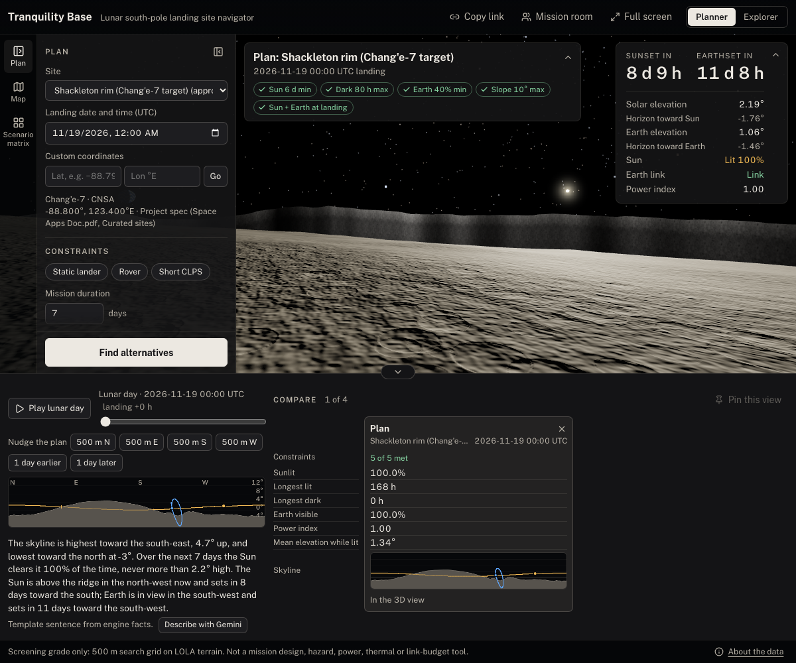

# Tranquility Base

A lunar south-pole landing site navigator, built for NASA Space Apps 2026 (Lunar Landing Site
Navigator challenge). Pick a site and a landing time, stand on the real LRO LOLA terrain in 3D, and
see the Sun and Earth exactly where they will be against the true horizon. Set mission constraints,
in fields or in a sentence, and when the launch slips, a finder ranks the nearby points and later dates
that still work and explains each one in a line of plain English.

**Live:** https://tranquility-base.rohansh2017.workers.dev



## Why

At the pole the Sun stays within about 1.5° of the horizon, so terrain decides whether a site is lit,
and a move of a few hundred metres or a slip of a few days can swing a site from sunny to dark.
Earth sits low and drifts in and out of view. The data to check this exists (Horizons, Quickmap,
Moon Trek), but checking one site and date means hopping between specialist tools, and a slipped
launch means checking many. Tranquility Base puts the check in one place and answers "what now?".

## Quick start

You need [uv](https://docs.astral.sh/uv/) and Node 22+. The app's data files are committed, so you do
**not** need the 7.3 GB of raw downloads to run or test it.

```sh
make setup && make dev        # http://localhost:5173
```

The full pipeline, from raw data to a tested app, is `make setup && make data-download && make data && make check`.

### What to try

The 3D view fills the window. It opens quietly: the Plan panel is open, and the plan card, the countdown
panel and the bottom panel are folded to one line each (unfold them with their arrows). Your plan's site, point
and date and your pinned scenarios are kept in this browser, so a refresh or the bare address brings them back;
a shared link with its own site wins. Press *Full screen* for a projector: it goes cinematic, folding the panels away
and fading the header and rail while the pointer rests (move the mouse or press a key to bring them back;
leaving full screen restores your layout). The countdown panel and the plan card collapse with their chevron;
the bottom panel drops and rises with the tab on its top edge, and resizes by dragging that edge (arrow keys work too;
double-click resets it). Choose a site and date (UTC) in
the Plan panel on the left, drag the lunar-day scrubber or press Play, drag inside the 3D view to look
around. Slip the date and press *Find alternatives*. Open a result: it is pinned to the *Compare* tray
at the bottom, beside the plan, and every column follows the same scrubber. The tray starts empty: pin up to four
scenarios (the pin on each result, or *Pin this view*; with your plan in the 3D view, *Pin this view* adds the plan's
live column, which follows your edits and shows each nudge's change). One column is the baseline (the first, until you press *Compare to this* on another): every other column
shows its differences from it, and the best value in each row is bold. The tray, the plan's place in it and the
baseline travel in the copied link. *Make this the plan* on a pin swaps it with the plan. Nudge the plan 500 m or a day and
watch the plan's tiles change. Type a custom coordinate, or open *Map* on the left rail and click
either map; the region map colours each 500 m cell by its sunlit % for the mission window. Open
*Scenario matrix* and click a cell. Plan, Map and Scenario matrix share the left edge, so opening one closes the
others. The alternatives list folds into its top-right corner with its minimize button and reopens from the chip. Switch to Explorer mode and press *Start tour*. *Copy link* gives
a URL that reopens the same plan. *About the data* (bottom right) lists the sources and everything
the 3D view invents.

On the deployed site two more things work that need the Cloudflare Worker: the *Mission room* header
button (start a room, open its link in a second browser; both follow each other), *Interpret with Gemini* under the
constraints ("survive 4 days of dark, talk to Earth half the time") and *Describe with Gemini* under
the panorama. Locally those report an error and everything else still works; the horizon sentence
then stays the engine's own template.

## Architecture in five lines

1. **Offline (Python, `build/`)**: Skyfield turns JPL DE440 and the NAIF lunar kernels into hourly Sun and Earth vectors for 2026–2035 in the LOLA frame; numba ray-marches a 360° horizon mask per grid point through the 20 m and 80 m LOLA DEMs out to 300 km; rasterio cuts heightmaps, slopes and hillshades. `make data` writes it all as small contract files.
2. **Engine (TypeScript, `web/src/engine/`)**: pure functions rotate the vectors into each site's local frame, apply Earth parallax, intersect the 0.53° solar disk with the mask, and compute every metric. A Python reference engine must agree on shared fixtures (`make parity`).
3. **Finder (Web Worker)**: one visibility series per candidate point, then prefix sums and run segments score every start date in O(1); 5,000 candidates × 60 days in under a second.
4. **UI (React + react-three-fiber)**: 3D scene in local metric coordinates with a silhouette ring from the mask, HUD, panorama, constraint panel, results, matrix, maps, modes, tour. Every number on screen comes from the engine, never from the renderer.
5. **Cloudflare**: Workers static assets serve the app, R2 serves the data files by region, a Durable Object keeps a mission room of browsers in step, and a Worker route calls Gemini with the constraint schema as the response schema.

More: [CLAUDE.md](CLAUDE.md) (invariants, data contracts, commands), [docs/spec/SPEC.md](docs/spec/SPEC.md) (the plan), [docs/DECISIONS.md](docs/DECISIONS.md) (every choice the spec left open).

## Validation results

Measured by `make validate` and `make perf`; the full tables are in [docs/VALIDATION.md](docs/VALIDATION.md) and [docs/PERF.md](docs/PERF.md).

| Check | Result | Target |
| --- | --- | --- |
| Engine Sun and Earth azimuth/elevation vs JPL Horizons, six sites, 720 hourly steps | max error 0.0007° | < 0.1° |
| Sunlit % vs PGDA average-illumination maps, nine sites × 441 points | Pearson r 0.95–0.99, means within 2 points; Connecting Ridge 3rd best-lit | pattern agreement |
| Slopes vs the LOLA slope map, nine sites | r 0.994–0.999, mean abs diff ≤ 0.33° | agreement |
| Python vs TypeScript engine on shared fixtures | angles within 1e-4°, metrics identical | parity |
| Finder, 5,000 candidates × 60-day range | 0.85–0.97 s | < 3 s |
| 3D frame rate during playback | 60 fps (Apple M1 Pro, M5) | ≥ 30 fps; not yet measured on a non-Apple laptop |
| Load for the demo region | 9.2 MB: 1.2 MB app + 5.5 MB data at start (ephemeris, orientation, stars) + 2.5 MB for the opened 5 m region | < 10 MB |

## Data sources and credits

- **Ephemeris:** JPL DE440 (`de440s.bsp`) and NAIF lunar orientation and frame kernels, NASA/JPL. Computed offline; the app never calls an ephemeris service.
- **Terrain:** LRO LOLA south-polar DEMs at 20 m and 80 m and the LOLA slope map, NASA GSFC Planetary Geodynamics Data Archive (PGDA). The same data behind Quickmap and Moon Trek.
- **Validation:** JPL Horizons (topocentric angles); PGDA average solar illumination maps (Mazarico et al. 2011); LOLA slope map.
- **Site coordinates:** NASA Artemis III (October 2024) and CLPS releases; PGDA product 78 site footprints for six polar sites; each site records its source and whether it is approximate.
- **Stars:** Yale Bright Star Catalogue, 5th revised edition (Hoffleit & Warren 1991), via Harvard's Telescope Data Center copy of VizieR V/50.
- **Close-range terrain:** LOLA 5 m site DEMs, PGDA product 78 (Barker et al. 2021).
- **Explorer text:** written by the team in our own words from NASA mission pages and Canadian Space Agency (CSA) Moon Exploration material.

File names, sizes and SHA-256 hashes: [docs/DATA.md](docs/DATA.md).

## Limits and non-goals

Screening grade: a 500 m search grid, 20 m terrain within 10 km of a point and 80 m beyond, 1° azimuth
bins, so small boulders and craters are missed and custom coordinates snap to the nearest grid point
(the app shows the distance). Horizon rays stop at the edge of the 80 m DEM (±304 km of the pole).
Nudges move by one grid point, not 100 m.

Not a mission design tool (no trajectories, fuel or launch windows), not a landing hazard assessment
(slope screening is an aid), not a power or thermal simulation (the power index is a relative number),
not a communications link budget (geometric Earth visibility only), and not global: terrain covers
80–90°S. Apollo 11, 15 and 17 are not in the app; they are used only by `make validate` to check Sun and Earth angles against JPL Horizons.

What the 3D view takes from data and what it invents: terrain relief is LOLA data, at 5 m for eight of
the nine sites (PGDA site DEMs) and 20 m for IM-2 Mons Mouton; stars are the 9,096 stars of the Yale
Bright Star Catalogue at their true positions for the site and hour; the Sun and Earth sit at their
ephemeris positions. The distant mountain ranges are a ring whose outline is the computed horizon and whose lighting comes
from the real LOLA slope at each crest and the real Sun, so ranges facing the Sun light up. Invented,
and labelled in the app: the ranges' rock texture, soil texture below the data's resolution
(bumps and craters under about 1.5 m, so it never contradicts the LOLA relief), the ground colour, the
Sun's glare, Earth's surface, star colours (approximated from each star's B−V index), and a faint
overhead fill when the Sun is hidden (real lunar shadow is black; the view says when it is brightened).
None of it feeds any number.

**Synthetic data:** none in the deployed app. `make data-fixtures` can generate synthetic
contract-shaped files for development; the app then shows a banner, and such files are never committed.

## Test

| Command | What it checks | Time |
| --- | --- | --- |
| `make test` | Python unit tests + TypeScript unit tests | ~5 s |
| `make parity` | Python engine and TypeScript engine give the same answers | ~3 s |
| `make e2e` | Opens the built app in headless Chromium, clicks through the demo path and every feature, saves screenshots to `web/tests/screenshots/` | ~2.5 min |
| `make e2e-room` | Starts the Worker locally (`wrangler dev`) and checks that three browsers in one mission room stay in step | ~25 s |
| `make check-changed` | Only the checks the files changed since `main` can affect (docs only: nothing; Python: ruff + pytest; engines or fixtures: parity + browser tests; web code: lint, typecheck, the unit tests that import the changed files, browser tests; mission room files: the room test). `PLAN=1` prints the plan without running it. **Run this before every push.** | 0 s to ~3 min |
| `make check` | Lint + typecheck + all of the above. **Run this before merging to `main` and before a deploy.** | ~4 min |
| `make e2e-live` | The browser tests, mission room and Gemini included, against the deployed site | ~50 s |
| `make validate` | Engine vs Horizons, sunlit % vs PGDA, slopes vs LOLA; rewrites `docs/VALIDATION.md`. The last two need `make data-download` | ~40 s |
| `make perf` | Finder timing, 3D frame rate on this machine's GPU, download sizes; rewrites `docs/PERF.md` | ~40 s |

After a UI change, open the screenshots in `web/tests/screenshots/` and look at them.

### Rebuild the data (only if the pipeline or site list changes)

```sh
make data-download   # ~7.3 GB into data/raw/ (resumable, idempotent)
make data            # ephemeris, orientation, stars, masks, slopes, heightmaps, basemaps -> web/public/data/ (~15 s)
make validate && make check
```

## Deploy

```sh
make deploy          # builds, uploads the data files to R2, publishes the Worker
```

Auth: `npx wrangler login` once, or `CLOUDFLARE_ACCOUNT_API_TOKEN` in `.env`. The Gemini key is a
Worker secret (`npx wrangler secret put GEMINI_API_KEY`). After a deploy, `make e2e-live` should pass
and print `x-data-source: r2`. Secrets live in `.env`, which is gitignored; never commit it.

## Repo map

`build/` Python pipeline, reference engine and validation scripts · `web/` the app, Worker and
browser tests · `web/public/data/` generated data files · `shared/fixtures/` engine parity fixtures ·
`docs/` plan, progress log, decisions, data, validation, traceability, one-pager, demo script, prize slides.
