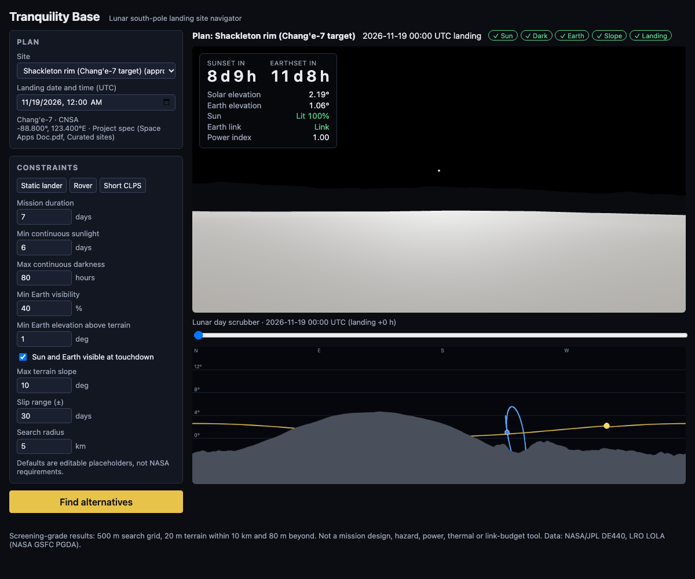

# 🌒 Tranquility Base — one-page summary

**NASA Space Apps 2026 · Lunar Landing Site Navigator** · ▶ **Live:** https://tranquility-base.rohansh2017.workers.dev

## The problem

At the Moon's south pole the Sun never climbs more than about 1.5° above the horizon, so **terrain decides whether a
landing site is lit**. A few hundred metres or a few days can swing a site from sunny to dark. When a launch slips
(Chang'e-7's August 2026 window was called off; Artemis's first crewed landing moved to 2028), planners have to re-check
sites and dates fast, across tools that were never meant to be used together.

## What Tranquility Base does

1. **See the whole south pole at a glance.** Every curated site is a pin on a LOLA-relief Moon under the real stars,
   solid if it meets your constraints and hollow if not.
2. **Stand on the real terrain** in 3D and watch the Sun and Earth move against the true horizon, with countdowns to
   sunset and Earthset.
3. **State the mission's needs** in fields, as presets, or as a sentence that Gemini turns into values you confirm.
4. **When the launch slips, ask "what now?"** The finder scans nearby points and later dates and ranks what still
   works. Each option comes in one line: *"5.0 km S, 12 days later: +97% sun, −158 h dark, +100% comms."* A failing
   plan says **why not**, and what would make it pass.
5. **Compare and decide together.** Pin options side by side, share a link, or plan in a live mission room.

## How it works

| | |
| --- | --- |
| **Ephemeris** | JPL DE440 + NAIF lunar kernels through Skyfield, hourly 2026–2035, in the LOLA frame (MOON_ME_DE440_ME421). Verified against JPL Horizons: **max error 0.0007°** at six sites (target 0.1°). |
| **Terrain** | LRO LOLA 5 m, 20 m and 80 m polar DEMs (NASA GSFC PGDA). A 360° horizon mask per grid point, ray-marched to 300 km with lunar curvature; the Sun is a 0.53° disk; Earth counts as visible 1° above the ridge. |
| **Checked against the world** | Our sunlit % matches PGDA's average-illumination maps at **r 0.95–0.99** across nine sites; our slopes match the LOLA slope map to 0.3°. |
| **All in the browser** | Precomputed files, a Web Worker and prefix sums: **5,000 candidates × 60 days in under a second**. |
| **On Cloudflare** | Workers serve the app, R2 serves the data, and a Durable Object keeps a mission room in step. |
| **Gemini, kept honest** | Reads sentences into constraint values and slip plans, and rewords results. Values must quote the user's own words; every number shown is the engine's, and any Gemini wording with a number that isn't a fact is replaced. |

## Objectives covered

| Challenge objective | In the app |
| --- | --- |
| Site selection and comparison | 9 curated south-pole sites, custom coordinates, Moon-view clicks, finder, scenario matrix, Compare tray, nudges |
| Date and time flexibility | UTC picker, lunar-day scrubber, slip-range search, year-long matrix, slip copilot |
| Sun and Earth visualization | 3D sky against the true horizon, Moon view with Sun and Earth bearings, panorama, countdowns |
| Power and comms assessment | Sunlit %, longest dark run, Earth visibility, power index, pass/fail per constraint, "why not?" |
| Multiple visualizations | Moon view, 3D ground view, panorama, scenario matrix, sunlight and Earth heat maps |
| Temporal dynamics | Scrubber, playback with trails, tracks across the mission window |
| Accessibility | Planner and Explorer modes, plain-language results, quick tour, science tour, share links, sentence entry |

## Limits

Screening grade: a 500 m search grid, 20 m terrain within 10 km and 80 m beyond. Not a mission design, hazard, power,
thermal or link-budget tool. Detail finer than the data in the 3D view is illustrative and labelled so.

**Data:** NASA/JPL DE440 and NAIF kernels · LRO LOLA via NASA GSFC PGDA · JPL Horizons and PGDA illumination maps for
validation · Yale Bright Star Catalogue · site coordinates from NASA Artemis III and CLPS releases and PGDA ·
Explorer text in our own words from NASA and CSA Moon Exploration material.
